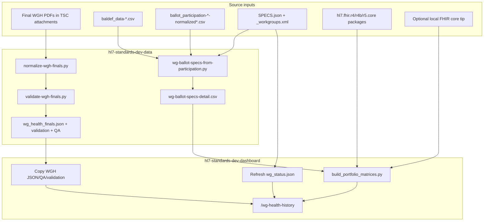

# Work Group Health History — data update runbook

How to refresh the data behind `/wg-health-history`.

Two repos are involved:

| Role | Path (local siblings) |
| --- | --- |
| **Data / ETL** | `../hl7-standards-dev-data` |
| **Dashboard UI** | this repo (`hl7-standards-dev-dashboard`) |

The page is offline-capable: it only reads JSON/CSV under `data/standards-development/`. After ETL, copy (or rebuild) those files here and restart or reload the app.



---

## What the page consumes

| Dashboard file | Powers | Refresh when |
| --- | --- | --- |
| `data/standards-development/wg_health_finals.json` | Portfolio heatmap, gold-star / band charts, cycle detail, WG drill-down | New Final WGH cycle published |
| `data/standards-development/wg_health_finals_validation.json` | Validation banner | After every WGH normalize |
| `data/standards-development/wg_health_finals_qa.md` | Human QA notes (not required by API) | After every WGH normalize |
| `data/standards-development/wg_health_finals_validation.md` | Human validation notes (not required by API) | After every WGH validate |
| `data/standards-development/wg_ballot_specs_matrix.json` | Specs-balloted matrix (+ Last 2 yrs / Δ computed in UI) | New ballot-participation export |
| `data/standards-development/wg_ballot_specs_detail.csv` | Source detail for the ballot matrix rebuild | Same as above |
| `data/standards-development/fhir_resource_ownership_matrix.json` | FHIR resources × version matrix | New FHIR core release (or tip refresh) |
| `data/standards-development/wg_status.json` | Sunset **⊘** markers | Jira work-group deprecations change |

`llm_context.md` in the same folder is **not** used by this page.

---

## A. Work Group Health Finals (core heatmap)

**Semantics (must match the published PDF legend):**

- Each Final is labeled by the **preceding** HL7 trimester it reports: Jan/Feb → prior-year T3, May → same-year T1, Sep → same-year T2 (e.g. `2026Sep` → `26T2`). There is no 26T3 until the next Jan Final.
- `prior_period_infractions` keeps the full T-column history strip (newest first). `total_infractions` is the **newest T-column only** (not a sum).
- Health bands: **0–3 green**, **4–7 yellow**, **8+ red**.
- **Gold stars** are the literal star icons printed on the PDF (detected from embedded images). They are not inferred from zero infractions — green rows can lack a star.

### A1. Source files needed

1. **Final** Work Group Health scorecard PDFs only (exclude Interim; exclude PBS workbooks for this page).
2. Stored under the data repo:

   `hl7-standards-dev-data/data/working/process-documents/workgroup-health/TSC/`

   Attachments live in:

   `TSC/attachments/{confluencePageId}/`

3. Typical filenames:

   - Early cycles (through ~2021May): per–steering-division PDFs  
     (`Administrative*WorkGroupHealth*`, `Clinical*`, `Infrastructure*`, `Org*Support*`).
   - Later cycles: combined `*FinalWGH.pdf` (watch `Corrected` / `updated` — prefer those).
4. When a **new Final cycle** appears, also extend `EXPECTED_CYCLES` in both:

   - `scripts/workgroup-health/normalize-wgh-finals.py`
   - `scripts/workgroup-health/validate-wgh-finals.py`

### A2. Process (data repo)

From `hl7-standards-dev-data` (venv with `pdfplumber`):

```bash
cd /path/to/hl7-standards-dev-data
# activate venv if you use one

python3 scripts/workgroup-health/normalize-wgh-finals.py
python3 scripts/workgroup-health/validate-wgh-finals.py
# exit code 0 = PASS; 2 = FAIL (fix still written)
```

**Outputs (data repo):**

- `data/working/process-documents/workgroup-health/wg_health_finals.json`
- `…/wg_health_finals_qa.md`
- `…/wg_health_finals_validation.json`
- `…/wg_health_finals_validation.md`

### A3. Copy into the dashboard

```bash
DATA=../hl7-standards-dev-data/data/working/process-documents/workgroup-health
DEST=data/standards-development

cp "$DATA/wg_health_finals.json" "$DEST/"
cp "$DATA/wg_health_finals_qa.md" "$DEST/"
cp "$DATA/wg_health_finals_validation.json" "$DEST/"
cp "$DATA/wg_health_finals_validation.md" "$DEST/"
```

(Paths relative to the dashboard repo root.)

### A4. Sanity checks

- Validation banner on `/wg-health-history` shows **PASS**.
- Latest Final appears in the portfolio heatmap and cycle selector.
- Spot-check a few known WGs (script prints checks for `2026Sep` / `2022May` / `2020May`).

---

## B. Specifications balloted by work group

### B1. Source files needed

From the data repo ballot-participation working set:

| File | Role |
| --- | --- |
| Latest `data/working/ballot-participation/baldef_data-*.csv` | Ballot definitions (spec, period, dates) |
| Matching `ballot_participation-*-normalized-v2.csv` (or current normalized export) | Participation rows joined by BALDEF ID |

Also fetched at run time by the script (network required):

- `https://raw.githubusercontent.com/HL7/JIRA-Spec-Artifacts/gh-pages/SPECS.json` (`defaultWorkgroup`)
- `https://raw.githubusercontent.com/HL7/JIRA-Spec-Artifacts/master/xml/_workgroups.xml` (display names)

### B2. Process (data repo)

```bash
cd /path/to/hl7-standards-dev-data

python3 scripts/ballot-participation/wg-ballot-specs-from-participation.py \
  --baldef-csv data/working/ballot-participation/baldef_data-YYYYMMDD-HHMMSS.csv \
  --ballot-csv data/working/ballot-participation/ballot_participation-YYYYMMDD-HHMMSS-normalized-v2.csv \
  --output-dir data/working/process-documents/workgroup-health
```

**Outputs:**

- `wg-ballot-specs-detail.csv` ← required for the dashboard matrix rebuild  
- `wg-ballot-specs-summary.csv`  
- `wg-ballot-specs-by-workgroup.md`

### B3. Rebuild matrix in the dashboard

`build_portfolio_matrices.py` reads the detail CSV from the sibling data repo by default (`BALLOT_DETAIL` env overrides), copies it into the dashboard, and writes the matrix JSON.

```bash
cd /path/to/hl7-standards-dev-dashboard

# Optional: point at an explicit detail CSV
# export BALLOT_DETAIL=/path/to/wg-ballot-specs-detail.csv

python3 data/standards-development/build_portfolio_matrices.py
```

**Writes:**

- `data/standards-development/wg_ballot_specs_detail.csv`
- `data/standards-development/wg_ballot_specs_matrix.json`
- (also rebuilds the FHIR matrix in the same run — see §C)

UI composites **Last 2 yrs** and **Δ prior 2 yrs** are computed in the browser from the trimester columns (latest 6 vs prior 6); no extra file.

---

## C. FHIR resources by work group

### C1. Source files needed

| Version | Source |
| --- | --- |
| R4 | `hl7.fhir.r4.core@4.0.1` from packages.fhir.org |
| R4B | `hl7.fhir.r4b.core@4.3.0` |
| R5 | `hl7.fhir.r5.core@5.0.0` |
| Current | Optional local FHIR core checkout tip (`../fhir/source` or `FHIR_SRC`) |

Packages must be extracted under:

`data/standards-development/tmp-fhir-packages/{r4,r4b,r5}/`

(`tmp-fhir-packages/` is gitignored.)

Example download:

```bash
PKG=data/standards-development/tmp-fhir-packages
mkdir -p "$PKG"
cd "$PKG"

curl -fsSL https://packages.fhir.org/hl7.fhir.r4.core/4.0.1  -o r4.tgz  && mkdir -p r4  && tar -xzf r4.tgz  -C r4
curl -fsSL https://packages.fhir.org/hl7.fhir.r4b.core/4.3.0 -o r4b.tgz && mkdir -p r4b && tar -xzf r4b.tgz -C r4b
curl -fsSL https://packages.fhir.org/hl7.fhir.r5.core/5.0.0  -o r5.tgz  && mkdir -p r5  && tar -xzf r5.tgz  -C r5
```

Ownership uses `StructureDefinition` `kind=resource`, non-constraint, extension `structuredefinition-wg`, remapped to WGH master keys in `build_portfolio_matrices.py` (`FHIR_WG_CODE_TO_KEY`).

### C2. Process

Same command as §B3:

```bash
python3 data/standards-development/build_portfolio_matrices.py
```

**Writes:** `data/standards-development/fhir_resource_ownership_matrix.json`

Bump package versions / tip path when HL7 publishes a new core release you want on the matrix.

---

## D. Sunset / retired work-group markers (⊘)

### D1. Source

Jira Spec Artifacts work-group list:

`https://raw.githubusercontent.com/HL7/JIRA-Spec-Artifacts/master/xml/_workgroups.xml`  
(`deprecated="true"`)

Keys are mapped to WGH master keys in the refresh step below (same idea as `normalize-wgh-finals` display names).

### D2. Refresh `wg_status.json`

From the dashboard repo (network required):

```bash
python3 - <<'PY'
import json
from datetime import datetime, timezone
from html import unescape
from pathlib import Path
from urllib.request import urlopen
import xml.etree.ElementTree as ET

OUT = Path("data/standards-development/wg_status.json")
URL = "https://raw.githubusercontent.com/HL7/JIRA-Spec-Artifacts/master/xml/_workgroups.xml"
JIRA_KEY_TO_MASTER = {
    "gas": "anesthesia", "att": "attachments",
    "cbcc": "community-based-care-and-privacy", "ec": "emergency-care",
    "mnm": "modeling-and-methodology", "pic": "process-improvement",
    "ps": "project-services", "templates": "templates",
    "fgb": "fhir-governance-board", "sgb": "standards-governance-board",
    "us-realm": "us-realm-task-force", "arb": "architecture-review-board",
    "hcd": "health-care-devices", "hsi": "health-standards-integration",
    "project": "ig-project",
}
DISPLAY = {
    "anesthesia": "Anesthesia", "attachments": "Attachments",
    "community-based-care-and-privacy": "Community-Based Care and Privacy",
    "emergency-care": "Emergency Care",
    "modeling-and-methodology": "Modeling and Methodology",
    "process-improvement": "Process Improvement Committee",
    "project-services": "Project Services", "templates": "Templates",
    "fhir-governance-board": "FHIR Governance Board",
    "standards-governance-board": "Standards Governance Board",
    "us-realm-task-force": "US Realm Task Force",
    "architecture-review-board": "Architecture Review Board",
    "health-care-devices": "Health Care Devices",
    "health-standards-integration": "Health Standards Integration",
    "ig-project": "IG Project",
}
root = ET.fromstring(urlopen(URL, timeout=60).read().decode("utf-8"))
deprecated = []
for wg in root.findall("workgroup"):
    if wg.get("deprecated") != "true":
        continue
    jira_key = wg.get("key")
    raw = unescape((wg.get("name") or jira_key or "").replace("&amp;", "&"))
    master = JIRA_KEY_TO_MASTER.get(jira_key) or (jira_key or raw).lower().replace(" ", "-")
    deprecated.append({
        "wg_key": master,
        "wg_name": DISPLAY.get(master, raw),
        "jira_key": jira_key,
        "jira_name": raw,
        "status": "deprecated",
    })
deprecated.sort(key=lambda r: r["wg_name"].lower())
OUT.write_text(json.dumps({
    "meta": {
        "generated_at": datetime.now(timezone.utc).isoformat(),
        "source": URL,
        "description": "Deprecated WGs from _workgroups.xml, mapped to WGH master keys.",
    },
    "deprecated": deprecated,
    "deprecated_keys": [r["wg_key"] for r in deprecated],
    "deprecated_names_lower": sorted({r["wg_name"].lower() for r in deprecated}),
}, indent=2) + "\n", encoding="utf-8")
print("Wrote", OUT, f"({len(deprecated)} deprecated)")
PY
```

If a newly deprecated Jira key is missing from `JIRA_KEY_TO_MASTER`, add the mapping so the ⊘ aligns with heatmap / ballot row keys.

---

## Suggested cadences

| Trigger | Run |
| --- | --- |
| New **Final** WGH published on Confluence | §A (normalize → validate → copy) |
| New ballot-participation export | §B then §B3/§C matrix rebuild |
| New FHIR core package you want on the matrix | Refresh packages (§C1) + §C2 |
| WG retired / `deprecated` flipped in Jira | §D |
| Minutes participation ETL finished | §E2 |
| Full refresh before a board pack | §A + §B + §C + §D + §E2 |

---

## After updating files

1. Confirm files exist under `data/standards-development/` (see table above).
2. Restart the dashboard process if it does not auto-reload JSON (`python run.py` / service).
3. Open `/wg-health-history` and check:
   - Validation **PASS**
   - New cycle / ballot columns present
   - Sunset ⊘ on known retired groups (e.g. Emergency Care on older Finals)
   - Ballot **Last 2 yrs** / **Δ** look sane when sorted

---

## Dependencies cheat sheet

| Step | Needs |
| --- | --- |
| Normalize WGH | `pdfplumber`, Final PDFs on disk |
| Validate WGH | `wg_health_finals.json` only |
| Ballot WG inventory | baldef + normalized participation CSVs, network for SPECS / workgroups |
| Portfolio matrices | Ballot detail CSV; FHIR package extracts (+ optional FHIR tip); network not required if packages already local |
| WG status | Network to fetch `_workgroups.xml` |

---

## Out of scope for this page

- PBS / Project Ballot Health Excel workbooks (legacy Final PDF archive only).
- Interim WGH reports.
- Standards Development Insights KPI CSVs (`all_kpis.csv`, etc.).

---

## E. Meeting participation (People / minutes)

Companion page: **`/wg-meeting-participation`**.

Offline JSON from the Confluence minutes-participation ETL in the data repo. Full agent handoff (contracts, acceptance checks, ETL refresh): [`MEETING_PARTICIPATION_AGENT_HANDOFF.md`](MEETING_PARTICIPATION_AGENT_HANDOFF.md).

### E1. Files consumed

| Dashboard file | Powers |
| --- | --- |
| `data/standards-development/wg_meeting_participation.json` | Portfolio KPIs + WG ranking |
| `data/standards-development/wg_meeting_participation_trimesters.json` | Trimester heatmap |
| `data/standards-development/wg_meeting_meetings.json` | Per-meeting drill-down / headcount chart (`meeting_type`, ConCalls match fields) |
| `data/standards-development/wg_meeting_people.json` | People panel |
| `data/standards-development/wg_meeting_organizations.json` | Organizations panel |
| `data/standards-development/wg_concalls_catalog.json` | ConCalls series/occurrences + DQ (optional but recommended) |
| `data/standards-development/wg_concalls_meeting_matches.json` | Minutes↔ConCalls match overlay |
| `data/standards-development/wg_status.json` | Sunset ⊘ markers (shared) |

Do **not** copy `minutes_cache.sqlite` or page bodies into this repo.

### E2. Copy after ETL rollup

From the dashboard repo root:

```bash
SRC="../hl7-standards-dev-data/data/working/process-documents/workgroup-health/minutes-participation"
DST="data/standards-development"
cp "$SRC"/wg_meeting_participation.json \
   "$SRC"/wg_meeting_participation_trimesters.json \
   "$SRC"/wg_meeting_meetings.json \
   "$SRC"/wg_meeting_people.json \
   "$SRC"/wg_meeting_organizations.json \
   "$DST"/
```

Re-copy after each successful Confluence sync or `--reparse` in the data repo. Restart / reload the dashboard, then open `/wg-meeting-participation`.

**WGM ConfiForms attendance logs** (e.g. `2026 Sept PC WGM Attendance`) store roster data outside page storage. After parser upgrades, refresh with:

```bash
# from hl7-standards-dev-data
python scripts/workgroup-health/minutes_participation/run_minutes_participation.py \
  --main-config data/config/main.yaml \
  --all-mapped --fetch-confiforms --lookback-months 24
```

Use `--refresh-confiforms` to re-download cached form JSON. Ordinary `--reparse` alone reuses already-fetched `confiforms_json`.

### E2b. ConCalls catalog + meeting_type

Scrape [HL7 Conference Call Center](https://www.hl7.org/concalls/), classify series as `main` / `project` / `other`, expand occurrences, and match to minutes (deterministic — no LLM in the matcher):

```bash
# from hl7-standards-dev-data
python scripts/workgroup-health/concalls/run_concalls.py \
  --out-dir ../hl7-standards-dev-dashboard/data/standards-development \
  --meetings-json ../hl7-standards-dev-dashboard/data/standards-development/wg_meeting_meetings.json \
  --lookback-months 24

# Merge matches into SQLite + regenerate dashboard JSON
python scripts/workgroup-health/minutes_participation/run_minutes_participation.py \
  --apply-concalls ../hl7-standards-dev-dashboard/data/standards-development/wg_concalls_meeting_matches.json \
  --out-dir ../hl7-standards-dev-dashboard/data/standards-development \
  --lookback-months 24
```

Optional residual series typing: add `--llm-classify` (needs `OPENAI_API_KEY`). Group map: `data/config/concalls_group_map.yaml` (accelerators / AI Office excluded from WG match pool).

Dashboard filter: Meeting type chips on `/wg-meeting-participation` (`main` | `project` | `wgm` | `other`).

### E2c. Unparseable residual + optional LLM attendance

After parser upgrades (FMG member grids, bold Attendees, Attending: prose, empty Attendance → `empty`):

```bash
python scripts/workgroup-health/minutes_participation/run_minutes_participation.py \
  --reparse --all-mapped --lookback-months 24
```

List residual LLM candidates (no API calls):

```bash
python scripts/workgroup-health/minutes_participation/run_minutes_participation.py \
  --llm-attendance-candidates \
  --out-dir ../hl7-standards-dev-dashboard/data/standards-development
```

Run LLM extraction dry-run / write-back (offline only; never from the dashboard):

```bash
OPENAI_API_KEY=... python .../run_minutes_participation.py \
  --llm-attendance --llm-attendance-limit 50 \
  --out-dir ...   # dry-run
OPENAI_API_KEY=... python .../run_minutes_participation.py \
  --llm-attendance --llm-attendance-write --llm-attendance-limit 50 \
  --out-dir ...
```

### E3. Cadence note

| Trigger | Run |
| --- | --- |
| Minutes participation ETL finished (or reparse) | §E2 copy |
| ConCalls refresh / meeting_type | §E2b |
| Unparseable parser upgrade | §E2c reparse, then §E2 / §E2b |
| Full board-pack refresh | §A–§D plus §E2 / §E2b |
